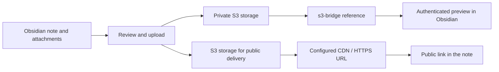

# Vault S3 Bridge

[English](README.md) | [日本語](README_JA.md)

Manage Obsidian attachments on AWS S3. Upload files linked from a note, replace their links or copy the generated Markdown, and preview private files inside Obsidian.

> Preview release (0.1.1). Not yet reviewed by Obsidian. Settings and behaviour may change between versions. Keep backups of your vault.

## Features

- Authenticate with IAM Identity Center (SSO) temporary credentials.
- Keep public HTTPS links and authenticated private previews separate.
- Upload images, PDFs, Office files and other local attachments from a note.
- Review uploads before sending, resume interrupted uploads, and archive uploaded originals.
- Prevent recorded private buckets and identical private content from being used for public uploads, within the [documented limits](docs/security.md#limits-of-the-protection).



## Requirements

| Component | Supported in this preview |
|---|---|
| Obsidian | Desktop 1.14.4 or later; tested on macOS with Obsidian 1.14.5 |
| Storage | AWS S3 general purpose buckets with SSE-S3 or SSE-KMS |
| Authentication | IAM Identity Center (SSO) profiles |
| S3-compatible storage | Not supported yet; custom endpoint settings are untested |
| Other credentials | Static access keys, role assumption, credential processes and web identity are not supported |

See [configuration and AWS access](docs/configuration.md) for permissions, settings and proxy support.

## External services and file access

- **Account and costs**: you need access to an AWS account with IAM Identity Center (SSO), a configured SSO profile and permissions for the target S3 bucket. The plugin is free; AWS storage, requests, data transfer and any delivery services you use may incur charges.
- **Network**: the plugin contacts AWS S3 to upload and retrieve attachments, STS to check the authenticated identity, and IAM Identity Center / SSO-OIDC to obtain temporary role credentials and refresh SSO tokens. If you configure a custom S3 endpoint, S3 requests go to that endpoint; S3-compatible storage is not supported in this preview. Requests use the configured direct or proxy connection. Public links use your configured CDN / HTTPS delivery service when opened or rendered.
- **Files outside the vault**: the AWS SDK reads shared AWS configuration and credentials files (normally `~/.aws/config` and `~/.aws/credentials`) and the SSO token cache (`~/.aws/sso/cache`) for authentication. The SDK can update that cache when refreshing an SSO token. AWS configuration file locations can be overridden by `AWS_CONFIG_FILE` and `AWS_SHARED_CREDENTIALS_FILE`.
- **Credentials**: temporary IAM role credentials are held in memory, not saved in plugin settings. SSO access and refresh tokens can be stored in the AWS SDK's local cache outside the vault. The plugin does not log these secrets.
- **Processes**: when using the system proxy on macOS, the plugin runs `/usr/sbin/scutil --proxy` with fixed arguments and no shell to read the proxy settings.

See [privacy, access and protection limits](docs/security.md#what-the-plugin-accesses) for details, including access to files inside the vault.

## Installation and setup

The plugin is not yet in Obsidian's community plugin list. Install it from a GitHub release using either method.

| Method | Steps |
|---|---|
| [BRAT](https://github.com/TfTHacker/obsidian42-brat) | Add this repository as a beta plugin. |
| Manual | Download `main.js`, `manifest.json` and `styles.css` from the latest release into `<vault>/.obsidian/plugins/vault-s3-bridge/`, then enable **Vault S3 Bridge** under **Settings → Community plugins**. |

1. Sign in with your configured SSO profile.

   ```bash
   aws sso login --profile <profile>
   ```

2. Add a storage connection in the plugin settings. Choose public or private, then set the alias, bucket and region.
3. Select the AWS profile for that connection on this device, and run **Test connection to storage**.
4. For public uploads, configure a CDN or other HTTPS delivery URL and set **Public base URL**. Keep S3 Block Public Access enabled; see [publishing public files](docs/configuration.md#publishing-public-files).

## Basic usage

| Task | Command |
|---|---|
| Review local attachments without uploading | **Show what would be uploaded from the current note** |
| Upload attachments and replace links or copy Markdown | **Upload attachments in the current note** |
| Reference a file already in private storage | **Insert reference to a private file** |
| Move eligible uploaded originals to `_s3-archive` | **Archive uploaded originals** |
| Restore archived originals | **Move archived files back** |

Run upload commands with a note open in Live Preview or Source mode. Both embeds and ordinary links are included; notes and Canvas files are excluded. Uploads use the default connection, ask you to choose one, or use the only available connection.

Private references keep the object key in the note without storing a pre-signed URL. Use the insertion command to encode the key correctly.

```markdown


[Report](s3-bridge://work/docs/report.pdf)
```

`work` is an example private connection alias. Its bucket and endpoint cannot be changed after creation. The AWS profile is selected per device. Private previews require the plugin and an authenticated profile; without the plugin, embedded references appear as broken images.

## Documentation

Detailed specifications are in [docs/](docs/README.md). These documents are in English.

| Topic | Contents |
|---|---|
| [Configuration and AWS access](docs/configuration.md) | Authentication, connection fields, defaults, proxies, public delivery and IAM permissions |
| [Private references and previews](docs/private-preview.md) | Reference syntax, supported preview types and memory limits |
| [Attachment uploads](docs/uploads.md) | Detection, exclusions, generated links, keys, conversion and public upload rules |
| [Recovery, sync and archiving](docs/recovery-and-archive.md) | Pending records, files to sync, archive checks and restoration |
| [Privacy and protection limits](docs/security.md) | Private-content records, concurrency limits, file/network access and credentials |
| [Development](docs/development.md) | Build, checks, local smoke tests and source layout |

Public uploads remove image metadata, but allowed non-image files are sent unchanged and some require explicit selection. Archiving moves originals inside the vault and does not free disk space. Review the specifications before using these features.

## Development

Requires Node.js 22 or later.

```bash
npm install
npm run build
npm run lint
npm test
```

See [development documentation](docs/development.md) for local AWS checks and third-party notices.

## License

[MIT](LICENSE). The bundle also includes packages under Apache-2.0, MIT and BSD-2-Clause licenses; see [THIRD_PARTY_NOTICES.md](THIRD_PARTY_NOTICES.md).
