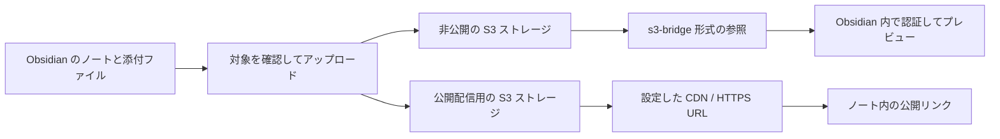

# Vault S3 Bridge

[English](README.md) | [日本語](README_JA.md)

Obsidian の添付ファイルを AWS S3 で管理するプラグインです。ノートから参照するファイルをアップロードし、リンクを置き換えるか、生成した Markdown をコピーできます。非公開ファイルは Obsidian 内でプレビューできます。

> プレビュー版 0.1.0 です。Obsidian の審査は受けていません。バージョンによって設定や動作が変わる場合があります。Vault のバックアップを保管してください。

## 主な機能

- IAM Identity Center（SSO）の一時認証情報で認証します。
- 公開用の HTTPS リンクと、認証が必要な非公開プレビューを使い分けられます。
- ノートが参照する画像、PDF、Office ファイルなどをアップロードできます。
- 送信前の確認、中断したアップロードの再開、送信済みの元ファイルの退避に対応しています。
- 非公開として記録したバケットや、非公開ファイルと同一の内容を公開先へ送信する操作を拒否します。[保護の制約](docs/security.md#limits-of-the-protection)も確認してください。



## 動作環境

| 項目 | プレビュー版の対応範囲 |
|---|---|
| Obsidian | デスクトップ版 1.14.4 以降。macOS で動作を確認しています。 |
| ストレージ | SSE-S3 または SSE-KMS を使う AWS S3 の汎用バケット |
| 認証 | IAM Identity Center（SSO）のプロファイル |
| S3 互換ストレージ | 未対応。カスタムエンドポイントの設定は未検証です。 |
| その他の認証 | 固定アクセスキー、ロールの引き受け、credential_process、Web Identity は未対応です。 |

権限、設定項目、プロキシの対応範囲は[設定と AWS アクセス](docs/configuration.md)に記載しています。

## インストールと初期設定

Obsidian のコミュニティプラグイン一覧には未登録です。GitHub のリリースから、次のいずれかの方法でインストールしてください。

| 方法 | 手順 |
|---|---|
| [BRAT](https://github.com/TfTHacker/obsidian42-brat) | このリポジトリをベータプラグインとして追加します。 |
| 手動 | 最新リリースの `main.js`、`manifest.json`、`styles.css` を `<vault>/.obsidian/plugins/vault-s3-bridge/` に配置し、「設定 → コミュニティプラグイン」で Vault S3 Bridge を有効にします。 |

1. 設定済みの SSO プロファイルでログインしてください。

   ```bash
   aws sso login --profile <profile>
   ```

2. プラグイン設定で接続を追加します。公開・非公開を選び、エイリアス、バケット、リージョンを設定してください。
3. この端末で使う AWS プロファイルを選び、「ストレージへの接続をテスト」を実行してください。
4. 公開先へアップロードする場合は、CDN などの HTTPS 配信 URL を用意し、接続の公開ベース URL を設定してください。S3 Block Public Access は有効のまま使います。詳しくは[公開ファイルの配信](docs/configuration.md#publishing-public-files)を参照してください。

## 基本操作

| 操作 | コマンド |
|---|---|
| 送信せずに添付ファイルを確認 | アップロード対象を確認 |
| 添付ファイルを送信し、リンクを置き換えるか Markdown をコピー | 現在のノートの添付ファイルをアップロード |
| 非公開ストレージにあるファイルへの参照を挿入 | 非公開ファイルへの参照を挿入 |
| 条件を満たす元ファイルを `_s3-archive` に移動 | アップロード済みの元ファイルを退避 |
| 退避した元ファイルを戻す | 退避したファイルを元の場所へ戻す |

アップロード時はノートを Live Preview またはソースモードで開いてください。埋め込みと通常のリンクが対象です。ノートと Canvas ファイルは対象に含まれません。既定の接続があればそれを使い、未設定なら接続を選びます。接続が 1 つだけの場合は、その接続を使います。

非公開ファイルは署名付き URL を保存せずにオブジェクトキーで参照します。キーを正しくエンコードするため、参照の挿入コマンドを使ってください。

```markdown


[Report](s3-bridge://work/docs/report.pdf)
```

`work` は非公開接続のエイリアスの例です。接続を作成したあとにバケットとエンドポイントは変更できません。AWS プロファイルは端末ごとに選びます。非公開プレビューにはプラグインと認証済みのプロファイルが必要です。プラグインがない環境では、画像の参照は表示できません。

## ドキュメント

詳しい仕様は [docs/](docs/README.md) にまとめています。仕様書の本文は英語です。

| 項目 | 内容 |
|---|---|
| [設定と AWS アクセス](docs/configuration.md) | 認証、接続項目、既定値、プロキシ、公開配信、IAM 権限 |
| [非公開参照とプレビュー](docs/private-preview.md) | 参照の書式、表示形式、メモリの制限 |
| [添付ファイルのアップロード](docs/uploads.md) | 検出と除外、生成するリンク、キー、変換、公開先への送信条件 |
| [再開・同期・退避](docs/recovery-and-archive.md) | 中断の記録、同期するファイル、退避の条件、元の場所への復元 |
| [プライバシーと保護の制約](docs/security.md) | 非公開ファイルの記録、同時操作の制約、ファイルとネットワークへのアクセス、認証情報 |
| [開発手順](docs/development.md) | ビルド、検査、ローカルの動作確認、ソースの構成 |

公開先へ送る画像はメタデータを除去します。画像以外の対応ファイルは変換せずに送り、一部の形式では確認画面での選択が必要です。元ファイルの退避は Vault 内での移動なので、ディスクの空き容量は増えません。利用前に各機能の仕様を確認してください。

## 開発

Node.js 22 以降が必要です。

```bash
npm install
npm run build
npm run lint
npm test
```

ローカルでの AWS を使った確認や、同梱ライブラリの通知の更新方法は[開発手順](docs/development.md)を参照してください。

## ライセンス

[MIT](LICENSE) です。バンドルには Apache-2.0、MIT、BSD-2-Clause のライブラリも含まれます。[THIRD_PARTY_NOTICES.md](THIRD_PARTY_NOTICES.md)を参照してください。
