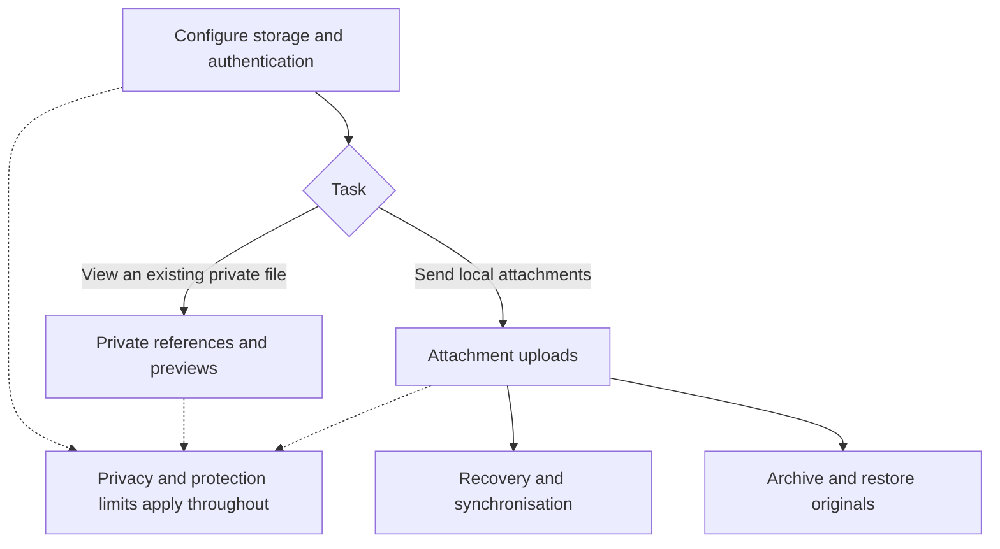

# Plugin specifications

[English README](../README.md) · [日本語 README](../README_JA.md)

These documents describe the current preview release. Start with the README for installation and basic usage. Detailed specifications are maintained in English.

| Document | Covers |
|---|---|
| [Configuration and AWS access](configuration.md) | Supported storage and authentication, connection identity, default settings, network, public delivery and permissions |
| [Private references and previews](private-preview.md) | Reference syntax, rendering types, link handling and preview limits |
| [Attachment uploads](uploads.md) | Commands, detection and exclusions, generated Markdown, key templates, metadata and public upload rules |
| [Recovery, synchronisation and archiving](recovery-and-archive.md) | Unfinished uploads, device records, sync exclusions, archive checks and restoration |
| [Privacy, access and protection limits](security.md) | Private-content protection, concurrency and persistence limits, local files, network and credentials |
| [Development](development.md) | Build and checks, local AWS smoke tests and source layout |

The diagrams summarise the main paths. The accompanying text specifies exclusions, failure behaviour and limits.
