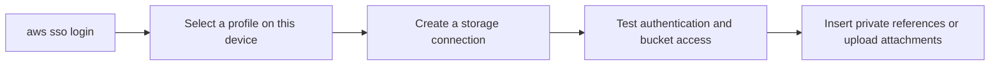

# Configuration and AWS access

[Documentation](README.md) · [English README](../README.md) · [日本語 README](../README_JA.md)

## Supported environment

The preview supports AWS S3 general purpose buckets with IAM Identity Center (SSO) profiles. Desktop Obsidian 1.14.4 or later is required; the plugin has been tested on macOS. Custom S3-compatible endpoints can be entered but are not supported or tested in this preview.

## Supported authentication (current)

| Credential source | Supported |
|---|---|
| IAM Identity Center (SSO) profile | Yes |
| Long-term access keys (static keys, environment variables) | No (rejected) |
| Role assumption (`role_arn`, `source_profile`, `credential_source`) | Not yet |
| `credential_process`, web identity | No |

Sign in with `aws sso login --profile <profile>` before using the plugin.

## Connection settings

| Field | Behaviour |
|---|---|
| Alias | Written in private references; 1–63 lowercase letters, digits or hyphens, starting with a letter or digit. Immutable after creation. |
| Bucket and endpoint | Identify the destination and cannot be edited after creation. A custom endpoint must use HTTPS. |
| Region | Required; can be corrected after creation. |
| Classification | Public or private. Private connections cannot become public. A target recorded as private cannot be used for a public connection. |
| Public base URL | Required for public uploads. HTTPS only, without credentials, query or fragment. |
| Key template | Stored per connection; see [Object keys](uploads.md#object-keys). |
| AWS profile | Selected separately on each device; not synchronised with the vault. |

Deleting a connection keeps its alias binding and private-target records. If synchronisation assigns competing targets to an alias, resolve the conflict in settings before using that connection.

## Default settings

Sizes labelled MB are calculated using 1,048,576 bytes. Upload and preview limits are separate.

| Setting | Default |
|---|---|
| Display language | Follow Obsidian (`auto`); Japanese and English are available |
| Default upload connection | Unset; choose a connection, or use the only available connection |
| Convert to WebP when smaller | Off; quality 85% |
| Remove metadata for private uploads too | Off |
| Maximum image size for uploads | 20 MB per image |
| Maximum size of other files for uploads | 100 MB per file |
| Maximum total of images per run | 200 MB; other files are not counted |
| Excluded note folders | None |
| Upload history limit | 2,000 entries |
| Preview image / PDF / text size | 20 / 50 / 5 MB |
| Preview image pixel limit | 40 megapixels |
| Preview cache | 100 MB |
| Proxy | None |
| Request timeout | 15 seconds |

The upload image pixel limit is fixed at 40 megapixels, independently of the configurable preview limit. See [Formats and metadata](uploads.md#formats-and-metadata) for conversion rules and memory limits.

## Network settings

Choose direct access, an explicit HTTP/HTTPS proxy URL, or macOS system proxy settings. Proxy URLs containing credentials are rejected. Environment proxy variables are not used. macOS PAC and auto discovery are not supported; the connection is direct when those are the only available system settings. The settings explain this fallback.

## Publishing public files

Keep S3 Block Public Access enabled and serve the bucket through a CDN such as Amazon CloudFront with origin access control. Set the connection's **Public base URL** to the https URL that serves the bucket (for example `https://cdn.example.com/`); public uploads are not possible without it. The link is this URL followed by the object key.

## Required permissions

Supported storage: AWS S3 general purpose buckets with SSE-S3 or SSE-KMS. Directory buckets are not supported. S3-compatible storage is not supported in this preview; a service would at least need conditional writes (`If-None-Match`) and SHA-256 checksums.

| Purpose | Permission |
|---|---|
| Upload | `s3:PutObject` |
| Check existence and checksum (reuse and resume) | `s3:GetObject` |
| Buckets encrypted with SSE-KMS | `kms:GenerateDataKey` and `kms:Decrypt` (also allowed by the key policy) |
| Tell a missing object apart from a denied one (optional) | `s3:ListBucket` |
| Private previews | `s3:GetObject` |
| Connection test (bucket reachability and Block Public Access) | `s3:ListBucket`, `s3:GetBucketPublicAccessBlock` |
| Connection test, optional write test (under `.vault-s3-bridge/connection-test/`) | `s3:PutObject`, `s3:DeleteObject`, `s3:GetBucketVersioning` (and `s3:DeleteObjectVersion` on buckets with versioning) |

Without `kms:Decrypt`, an upload can succeed while the later checksum checks fail. The plugin then stops and keeps the record instead of uploading another copy.

Example policy for the role used by a connection (replace the placeholders):

```json
{
  "Version": "2012-10-17",
  "Statement": [
    {
      "Effect": "Allow",
      "Action": ["s3:PutObject", "s3:GetObject"],
      "Resource": "arn:aws:s3:::<bucket>/attachments/*"
    },
    {
      "Effect": "Allow",
      "Action": ["kms:GenerateDataKey", "kms:Decrypt"],
      "Resource": "arn:aws:kms:<region>:123456789012:key/<key-id>"
    }
  ]
}
```

Leave out the KMS statement for buckets that use SSE-S3.

## Connection diagnostics

Run **Test connection to storage** from the command palette or use the test control in settings. The optional write test uses `.vault-s3-bridge/connection-test/`; its permissions are listed above.



Implementation: [setting defaults](../src/settings/types.ts), [validation](../src/settings/validate.ts), [alias and classification rules](../src/settings/registry.ts), [device state](../src/settings/device.ts), [connection diagnostics](../src/diagnostics/connectionTest.ts).
