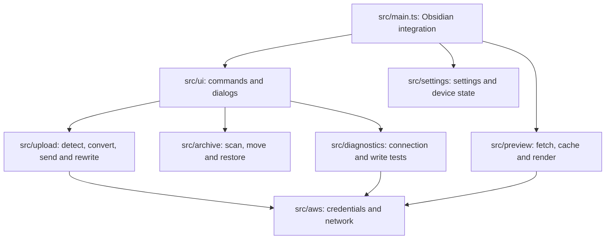

# Development

[Documentation](README.md) · [English README](../README.md) · [日本語 README](../README_JA.md)

## Build and checks

```bash
npm install
npm run build      # typecheck + production bundle
npm run lint
npm test
```

Maintainers can run local-only checks against a real AWS account (never in CI):

```bash
npm run smoke:aws              # connection diagnostics using local/dev.json
npm run smoke:preview          # fetch test images through the preview service
npm run smoke:upload           # conditional writes and checksums against a real bucket, then cleanup
npm run check:local-values     # make sure no real environment values are tracked
```

`node scripts/third-party-notices.mjs` rewrites `THIRD_PARTY_NOTICES.md` from the packages bundled into `main.js`; run it when dependencies change.

## Source layout



| Area | Specification |
|---|---|
| Settings, device profile and AWS access | [Configuration](configuration.md) |
| Reference syntax and rendering | [Private references and previews](private-preview.md) |
| Detection, conversion, keys and note updates | [Attachment uploads](uploads.md) |
| Interrupted sends, sync and originals | [Recovery and archiving](recovery-and-archive.md) |
| Local data and protection boundaries | [Privacy and protection limits](security.md) |

Keep examples free of real account, profile, bucket and network values. Do not run real AWS checks in CI.
