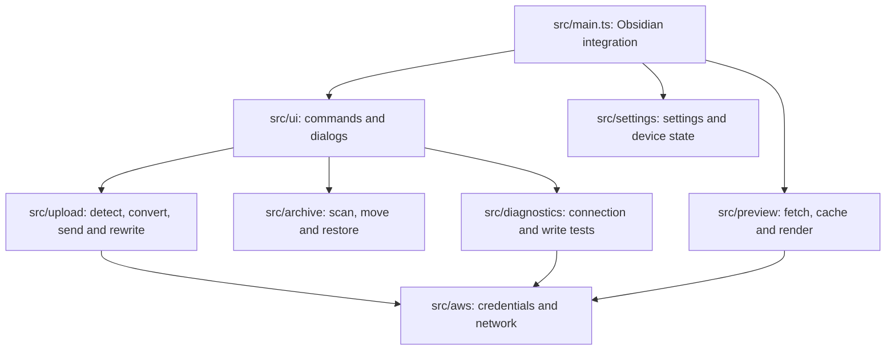

# Development

[Documentation](README.md) · [English README](../README.md) · [日本語 README](../README_JA.md)

## Build and checks

```bash
npm install
npm run build      # typecheck + production bundle
npm run lint
npm test
```

Maintainers can run local-only checks against a real AWS account (never in CI):

```bash
npm run smoke:aws              # connection diagnostics using local/dev.json
npm run smoke:preview          # fetch test images through the preview service
npm run smoke:upload           # conditional writes and checksums against a real bucket, then cleanup
npm run check:local-values     # make sure no real environment values are tracked
```

`node scripts/third-party-notices.mjs` rewrites `THIRD_PARTY_NOTICES.md` from the packages bundled into `main.js`; run it when dependencies change.

## Source layout



| Area | Specification |
|---|---|
| Settings, device profile and AWS access | [Configuration](configuration.md) |
| Reference syntax and rendering | [Private references and previews](private-preview.md) |
| Detection, conversion, keys and note updates | [Attachment uploads](uploads.md) |
| Interrupted sends, sync and originals | [Recovery and archiving](recovery-and-archive.md) |
| Local data and protection boundaries | [Privacy and protection limits](security.md) |

Keep examples free of real account, profile, bucket and network values. Do not run real AWS checks in CI.

## Community submission and release checks

Production builds are bundled without minification so reviewers can inspect the distributed code. The third-party notice generator uses the same minification setting; regenerate the notices when bundled dependencies change.

Before publishing a corrected release:

1. Check that both READMEs disclose the AWS account requirement, possible service charges, network destinations, access to AWS files outside the vault, SSO token cache updates and the macOS proxy command. Keep these disclosures consistent with [Privacy, access and protection limits](security.md).
2. Run `npm run lint`, `npm run build` and `npm test`. Network and S3 tests use loopback HTTP servers and need permission to listen on `127.0.0.1`; a sandbox that denies listening cannot run those cases. These tests do not need AWS credentials.
3. In a test vault on Obsidian Desktop 1.14.5, enable the newly built plugin, open a private reference and confirm its authenticated preview. Check an ordinary HTTPS link, disable the plugin and check the ordinary link again, then re-enable and check the private preview again. Include a popout window. Record the app version and result; automated link-guard tests cover wrapper restoration but do not replace this app check. Record 1.14.5 as the tested version; the declared minimum remains 1.14.4.
4. Increment the patch version consistently in `package.json`, `package-lock.json`, `manifest.json` and `versions.json`, and update the preview version in both READMEs. Commit the corrected sources and manifest to the default branch before submitting.
5. Publish a GitHub release whose tag exactly matches the new manifest version, with the newly built `main.js`, `manifest.json` and `styles.css` attached. Check that the attached manifest matches the committed manifest and that all three assets match the local release files. Do not replace the assets of an older release with a different build under the same version.
