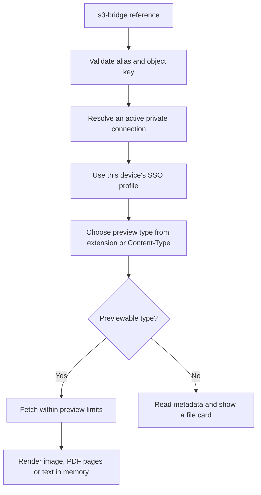

# Private references and previews

[Documentation](README.md) · [English README](../README.md) · [日本語 README](../README_JA.md)

## Preview flow



Invalid references, missing profiles, alias conflicts and access errors show a placeholder rather than opening an external application. The diagram describes the successful lookup path; content checks can also fall back to a file card.

Implementation: [reference parser](../src/reference/reference.ts), [preview service](../src/preview/service.ts), [rendering](../src/preview/display.ts), [link handling](../src/preview/linkGuard.ts).

## Reference syntax

Images in a private bucket are referenced with the plugin's own scheme and shown inside Obsidian after authenticating with your AWS profile:

```markdown


```

- `work` is the alias of a private storage connection. An alias always points to the same bucket: alias, bucket and endpoint cannot be changed after the connection is created.
- Use the command **Insert reference to a private file** to create references; it encodes the object key correctly.
- No pre-signed URL is ever written to the note. Files are downloaded on demand and kept in memory only.
- The AWS profile is chosen per device and is not synchronised with the vault.
- Without the plugin, the reference stays in the note as text and Obsidian shows a broken image. Obsidian cannot load the `s3-bridge:` scheme, so nothing is sent over the network.

What is shown depends on the extension of the key, decided before anything is downloaded:

| Extension | Shown as |
|---|---|
| `png` `jpg` `jpeg` `gif` `webp` | Image |
| `svg` | Image (scripts in it do not run) |
| `pdf` | Pages drawn as pictures, as they scroll into view. Links, forms, attachments and scripts in the PDF do nothing |
| `txt` `text` `log` `csv` `tsv` `json` | Plain text, read as UTF-8 (only the beginning of a long file) |
| Anything else (Office, ZIP, audio, video, …) | A card with the name, type and size; only the object's metadata is read |
| No extension | Chosen from the object's Content-Type |

- SVG and text are shown only when their content matches the extension; otherwise a card is shown. Password-protected and damaged PDFs are also shown as a card.
- The size limits are in the settings (**Preview**).
- A link such as `[Report](s3-bridge://work/docs/report.pdf)` opens the same preview in a window inside Obsidian, in Reading view, Live Preview and Source mode, whether opened by a click (with or without a modifier key), the keyboard or the context menu, also in pop-out windows. It is never passed to a browser or another application. This holds only while the plugin is enabled: otherwise Obsidian handles the link as it does any unknown scheme.

Limits of the preview:

- The plugin and its libraries never write downloaded content to disk. Electron and the operating system may still do so on their own (for example, memory swapped out to disk).
- PDF pages are drawn within a fixed memory budget; pages out of view are released first, and a page that does not fit is not shown. The budget is set by calculation, not measured on every machine.
