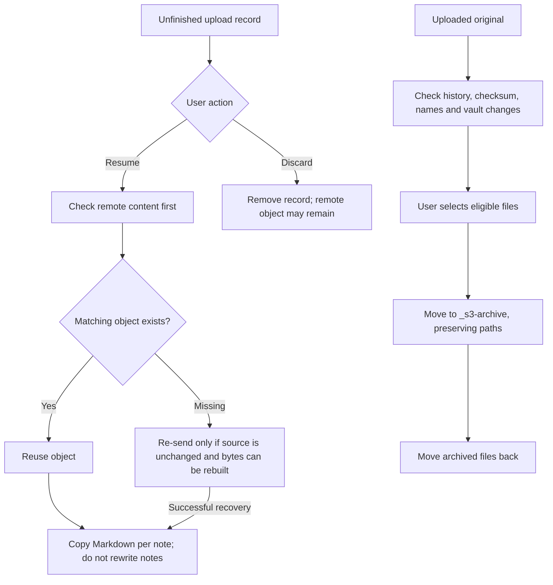

# Recovery, synchronisation and archiving

[Documentation](README.md) · [English README](../README.md) · [日本語 README](../README_JA.md)

## Recovery and archive flow

An object that cannot be verified or rebuilt can remain unresolved. Discarding a record does not delete the stored object. Archiving and restoring are separate commands from upload recovery.

Implementation: [pending records](../src/upload/pending.ts), [upload transitions](../src/upload/transitions.ts), [archive checks](../src/archive/archive.ts), [restore](../src/archive/restore.ts).

## Unfinished uploads

Before each file is sent, the plugin writes a record to its folder (`pending-<device-id>.json`). If Obsidian quits, the upload is stopped or the result is unknown, the record stays and is listed under **Unfinished uploads** in the settings:

- **Resume** checks each file on the storage first and sends it again only if it is missing and the source file is unchanged. Resuming never changes the links in your notes; copy the Markdown afterwards from the same list (per note).
- **Discard** removes a record. The object may remain on the storage, and the plugin can no longer prevent a second copy of it.
- Records from another device are shown separately and are never resumed automatically. You can take them over on this device or discard them.
- Records are written in a newer format than earlier versions of the plugin read. Going back to an earlier version is not supported: it shows the records as damaged. Do not reset or discard them there; install this version again, and it reads them as they were.

## Syncing the vault with Git or another tool

The plugin writes these files to `.obsidian/plugins/vault-s3-bridge/`:

| File | Content | Share between devices |
|---|---|---|
| `data.json` | Settings, upload history, private records | Yes |
| `private-files.json` | Checksums of content sent to private storage | Yes (records from all devices are merged) |
| `pending-*.json` | Unfinished uploads of one device | No: add `pending-*.json` to `.gitignore` |
| `*.tmp-*` | Temporary file, normally removed right away; may remain after a crash | No: add `*.tmp-*` to `.gitignore` |

## Archiving uploaded originals

**Archive uploaded originals** moves source files that are already on the storage into `_s3-archive` in the vault, keeping their paths. Nothing is deleted, and **Move archived files back** (a command, also under **Archived files** in the settings) returns them. A file is offered only if it is within the upload size limits, no text in the vault names it, the upload history has its current content, the storage still holds that content (checked by checksum), and no other file in the vault has the same name.

A file counts as named when its file name appears anywhere in a text file of the vault, after decoding `%`, JSON, HTML and Markdown escapes. Matching is deliberately broad: a false match only keeps a file where it is.

- `s3-bridge://` references are not counted. Their key usually ends with the same file name, but they point to the storage, not to the vault file.
- The visible text of a link the upload wrote is counted. For files that are not images, and for links, this text is the file name with its extension, so those originals stay named and are not offered until you change the text. Image embeds use the name without its extension and are not affected.
- Public links (`https://…`) are counted like any other text, so an original sent to public storage under its own name is not offered.
- Not found: references in formats of other plugins, from outside the vault, and changes on other devices that are not synced yet.
- Decodings are tried in one order (escapes, then `%`, then Unicode normalisation). A name hidden by the reverse order, such as JSON or HTML escapes inside `%`-encoding, is not found.
- The vault is watched from the start of the search until the last file is moved, and the command stops if anything changes. A change made by another tool (such as a sync client) after a move has started cannot be prevented.
- Archiving does not free space: the files stay in the vault, and sync tools keep copying them. Delete the archive folder, or exclude it from sync, once you no longer need the originals.
