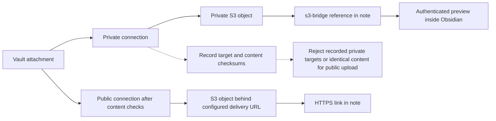

# Privacy, access and protection limits

[Documentation](README.md) · [English README](../README.md) · [日本語 README](../README_JA.md)

## Public and private paths

Connection classification is a plugin rule. It does not change S3 bucket policies, ACLs or a CDN's configuration. Use IAM and bucket policies to enforce access independently of the plugin.

## Limits of the protection

Buckets registered as private are recorded so that the plugin never uses them for public connections, even after the connection is deleted or settings are synchronised from another device. Content sent to private storage is recorded by checksum (in `data.json` and `private-files.json`), and the plugin refuses to upload the same content to public storage.

- Only identical bytes are recognised. An image that was re-saved, edited or converted elsewhere looks the same but is not detected.
- Not tracked: history removed before a connection became private, records of other devices that have not been synchronised yet, and files placed in private buckets by other means.
- Sending content to private storage does not remove a copy sent to public storage earlier. The confirmation screen warns about it.
- Two devices uploading at the same time before their records are synchronised can still send the same content to public storage.
- Anyone who can edit the plugin's files can remove the records. Enforce access with IAM and bucket policies (for example, never grant the public upload role access to private buckets).
- Settings are saved through Obsidian, which does not write files atomically. A record saved by this device survives a crash of Obsidian, but not a power loss or an OS crash. Records synchronised from another device but not yet read on this device can be overwritten; they come back from that device at the next synchronisation.
- If Obsidian's image encoder changes between an interrupted upload and its resume, the image may not be rebuilt exactly. The record is then kept as needing attention for you to keep or discard.
- Replacing links in a note that is not open: the plugin writes only if the note on disk is exactly what it read before uploading, and reads it again right before writing. A sync client or another program that writes the same note in the same instant can still lose its change or undo the replaced links (the uploaded files stay on the storage). Notes open in Obsidian are changed through the editor and are not affected. A replaced note cannot be restored with Undo unless it was open.

## What the plugin accesses

- **Files**: the AWS shared config files (`~/.aws/config`, `~/.aws/credentials`) and the IAM Identity Center token cache (`~/.aws/sso/cache`), read through the AWS SDK. Inside the vault: the files that the note you upload from embeds or links to, the note itself (changed only when you choose to replace links), and the plugin's own files listed in [Recovery, synchronisation and archiving](recovery-and-archive.md#syncing-the-vault-with-git-or-another-tool). **Archive uploaded originals** reads every text file in the vault (dot folders included, the configuration folder excluded) to look for names, and moves only the files you choose into `_s3-archive`. Nothing else outside the vault.
- **Clipboard**: written when you copy references, Markdown or the command shown by the connection test.
- **Network**: AWS endpoints (IAM Identity Center, STS and S3, with the S3 operations in the [permissions table](configuration.md#required-permissions)) and, for connections that set one, the custom endpoint you configure (not supported yet). Requests go directly, through the proxy URL you enter, or, on macOS, through the HTTPS proxy of the system settings and its exceptions (automatic proxy configuration with a PAC file or auto discovery is not supported: the connection is then direct, and the settings say why). Proxy settings in environment variables are never used.
- **Processes**: only when the proxy is set to use the system settings on macOS, the plugin runs `/usr/sbin/scutil --proxy` (fixed arguments, no shell) to read them, at most every 30 seconds while connecting. No other process is started.
- **Secrets**: none are written to disk or logged. Temporary credentials for previews are kept in memory per connection and dropped shortly before they expire; the connection test and uploads resolve them on each run without keeping them.
