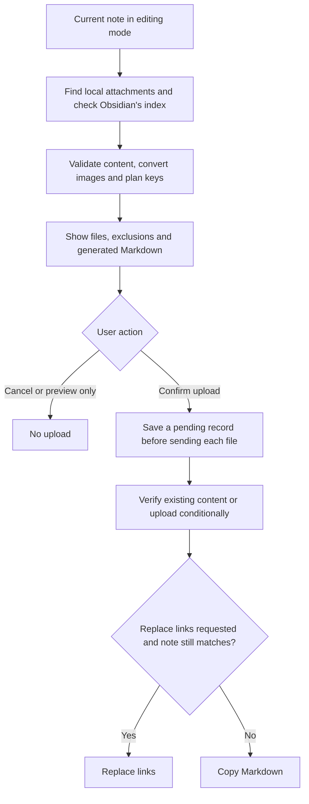

# Attachment uploads

[Documentation](README.md) · [English README](../README.md) · [日本語 README](../README_JA.md)

## Upload flow

Interrupted or uncertain sends keep their records for [recovery](recovery-and-archive.md#unfinished-uploads). The diagram omits failure branches; it does not imply that every planned file is uploaded.

Implementation: [attachment detection](../src/upload/detect.ts), [conversion](../src/upload/convert.ts), [object keys](../src/upload/key.ts), [uploader](../src/upload/uploader.ts), [note updates](../src/upload/obsidianJob.ts).

## Commands and confirmation

Open a note in editing mode (Live Preview or Source mode) and run one of these commands:

- **Show what would be uploaded from the current note**: lists the files and the planned keys without sending anything.
- **Upload attachments in the current note**: shows the same list, then uploads.

Both embeds (`![[a.png]]`, ``) and links (`[[doc.pdf]]`, `[t](doc.pdf)`) to files in the vault are uploaded. Links to notes and Canvas files are left alone.

The connection used is the **Default connection** from the settings; otherwise you choose one (a single connection is used without asking).

The confirmation screen shows, for each file, its status, format and Content-Type, the object key, the size before and after conversion and the Markdown that will be written. Files that are not uploaded are listed with the reason. Then choose:

- **Upload and replace links in the note**: the embeds and links are replaced in place. Text you typed but has not been saved yet is kept, and the change can be undone with Undo. If the note was changed, closed, renamed, moved or deleted during the upload, the links are not replaced and the Markdown is copied instead. A note changed by another program at the very moment the plugin writes it is not covered; see [Limits of the protection](security.md#limits-of-the-protection).
- **Upload and copy the Markdown**: the note is not changed. The copied Markdown is based on the note as it was when the upload was prepared.

Generated links:

| In the note | Private connection | Public connection |
|---|---|---|
| `![[a.png]]` | `` | `` |
| `![[a.png\|300]]` | `` | `` |
| `` | `` | `` |
| `![[doc.pdf]]` | `` (previewed) | `[doc.pdf](https://<public-base-url>/<key>)` (a link) |
| `[[doc.pdf]]` | `[doc.pdf](s3-bridge://<alias>/<key>)` | `[doc.pdf](https://<public-base-url>/<key>)` |
| `[[doc.pdf\|Report]]`, `[Report](doc.pdf)` | `[Report](s3-bridge://<alias>/<key>)` | `[Report](https://<public-base-url>/<key>)` |

A link stays a link and an image embed stays an embed. Inside tables, `|` is escaped as `\|`. Reference-style definitions (`[id]: doc.pdf`) are listed but not rewritten.

**Not uploaded** (the reason is shown): external URLs and existing `s3-bridge://` references, embeds in comments, code or front matter, links to a heading or block, links with a title, files that are not found or cannot be read, images that cannot be decoded, files over the size or pixel limits, archived files, and notes in an excluded folder. When the plugin cannot read a part of the note safely, it stops instead of guessing: for example, a comment containing inline code with `%%` in it. It also stops when the embeds and links it found differ from Obsidian's own index of the note, even where an earlier version would have uploaded the images.

The same file is uploaded once per run, and a file uploaded before (within the upload history) is reused after its checksum is confirmed on the storage.

### Object keys

Each connection has a **Key template for uploads**. Variables:

| Variable | Value |
|---|---|
| `{year}` `{mon}` `{day}` | Date of the upload |
| `{filename}` | File name without extension |
| `{ext}` | Extension of the format that is sent |
| `{notename}` | Name of the note |
| `{foldername}` | Name of the note's folder (last part of the path; `_` at the vault root) |
| `{hash}` | First 16 hex characters of the SHA-256 of the bytes that are sent |

Defaults:

- Private: `attachments/{year}/{mon}/{notename}/{filename}.{ext}`
- Public: `attachments/{year}/{mon}/{hash}.{ext}`

A public URL reveals the key, so the settings warn when a public template uses `{notename}`, `{foldername}` or `{filename}`. Templates that cannot produce a valid key (empty segments, `.` or `..`, a leading `/`, more than 1024 bytes) are rejected. If a key is already used by different content, the file is uploaded once under a key with a short suffix.

### Formats and metadata

| Image | Public connection | Private connection (default) | Private with **Remove metadata for private uploads too** |
|---|---|---|---|
| PNG, JPEG, WebP | Re-encoded to the same format to remove metadata | Sent as is | As public |
| GIF (still) | Re-encoded as PNG | Sent as is | As public |
| Animated GIF, PNG or WebP | Not uploaded | Sent as is | Not uploaded |

- Metadata such as Exif, GPS, XMP and text chunks is removed by re-encoding. The ICC color profile that the encoder writes is kept; it describes colors, not the image's origin.
- If metadata cannot be removed, the image is not uploaded. The original bytes are never sent as a fallback.
- **Convert to WebP when smaller**: when an image is re-encoded, a WebP version is also made and the smaller one is sent.
- Images over 40 megapixels, and images whose size cannot be read from the header, are not uploaded.
- **Maximum image size for uploads** applies to each image; converted images are kept in memory until they are sent, so images beyond **Maximum total of images per run** are left for the next run (other files are not counted).
- Content-Type is set from the bytes that are sent. The plugin sets no ACL and no Cache-Control.

Files that are not images are sent as they are, never converted, with a fixed Content-Type chosen from their content (`text/plain; charset=utf-8` for text). **Maximum size of other files for uploads** applies to each of them; a file is read whole into memory for a single request. An upload has no limit on its total time. While the file is being sent, it stops if the network takes no data for the request timeout set in **Network**; otherwise only when you stop it from the progress notice.

What may go to public storage:

| Format | Public connection |
|---|---|
| Images | As above (metadata removed) |
| Text (`txt` `log` `csv` `tsv` `json` …) | Uploaded as `text/plain; charset=utf-8` |
| PDF, Word, Excel, PowerPoint, ZIP, audio, video | Only the files you tick on the confirmation screen. Their metadata is not removed, and they may contain scripts or macros |
| SVG, HTML, XML, JavaScript, CSS and similar; text whose content is HTML, SVG or XML; anything whose format cannot be told apart | Never |

- An object already on the storage is reused for a public link only if its Content-Type is exactly the one the plugin would send and it has no Content-Disposition. Otherwise the file is uploaded under another key.
- Not checked: scripts, macros or other active parts inside an allowed format (a PDF's JavaScript, an Office macro). Not guaranteed: what a CDN does to the headers when it serves the file.
- Private storage accepts every format; previews show them as described in [Private references and previews](private-preview.md).
